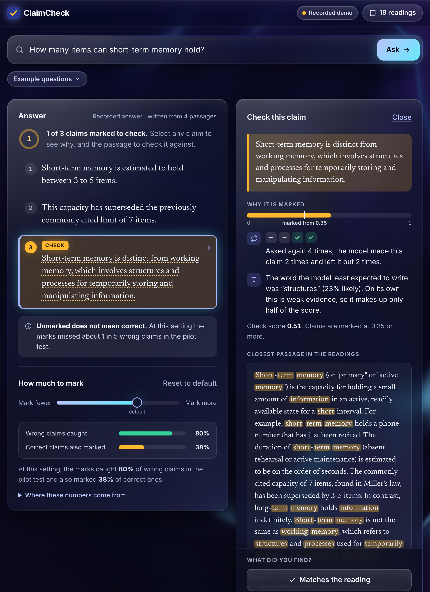

# ClaimCheck

[](https://github.com/gokay-ai/claimcheck/actions/workflows/ci.yml)

A study assistant that answers from a set of readings and marks which claims in its answer a student should check.

**README prose word count: 1432** (code and commands not counted)



## Project status

**What it is.** A student asks a question. ClaimCheck answers from 19 readings, splits the answer into claims, and marks the claims with the most reason to doubt. Selecting a claim shows why it is or is not marked and the closest passage in the readings. The student can move the marking threshold, and the interface shows what each setting caught and wrongly marked in a pilot test.

**Works**

- Asking, the three-step progress display, the marked answer, the threshold control, the check panel and recording a finding (✓ or ✕) on a claim.
- The pipeline with a live model: retrieval, an answer with token probabilities, four re-asked answers, a verdict per claim, a check score, the closest passage.
- Declining a question the readings do not cover, before any model call.
- A pilot evaluation of the signals on 261 labelled claims ([docs/evaluation.md](docs/evaluation.md)).

**Simulated**

- The recorded demo. With no model key, the app replays 7 unedited live results and labels them as recorded. Other questions need a key.

**Unfinished**

- The pilot's labels were made by a second model and have not all been checked by hand.
- Only 4 wrong claims occurred when answering from the readings, so the measured rates lean on answers written without them.
- The coverage check declined 5 of 49 questions that the readings do answer.
- Planned and not built: a passage-support signal, a student's own readings, findings that tune the threshold, and a study with students.

## Technology stack

| Part | Technology | What it does |
|---|---|---|
| API | Python 3.12, FastAPI, httpx, pydantic | Runs the pipeline and streams progress and the result |
| Retrieval | BM25, written in `retrieval.py` | Ranks 434 passages; no embedding service |
| Model | `openai/gpt-4o-mini` through OpenRouter | Writes the answer and re-asks, judges re-asks against claims |
| Interface | React 19, TypeScript, Vite, plain CSS; one WebGL shader for the backdrop; Inter and Newsreader fonts, bundled | The screens a student uses: dark glass by default, with a light theme in the footer |
| Readings | 19 Wikipedia articles, CC BY-SA 4.0 | The corpus, with a permanent link per passage |
| Evaluation | Python; Claude Haiku 5.5 and Claude Sonnet 5.5 through OpenRouter | Writes test questions and labels claims |
| Tests | pytest, mypy, ruff; vitest, ESLint; Playwright | 44 backend, 9 frontend and 4 browser tests |
| Packaging | Docker, GitHub Actions | One container; lint, types and tests on each push |

**Why this model.** The token-probability signal needs log-probabilities, which only about a third of the models listed on OpenRouter offer. `gpt-4o-mini` returns them reliably and cheaply. `qwen/qwen3-next-80b-a3b-instruct` also ran the whole pipeline on two test questions and can be set in `.env`, but the rates shown beside the threshold were measured with `gpt-4o-mini` only.

**Still undecided**

- Whether to keep token probability in the score. It was at chance on the model's own errors in the pilot.
- Whether to replace lexical retrieval with embeddings, given the wrongly declined questions.

## Running or inspecting the work

A hosted copy runs at https://iis.puko.ai. The badge in its header says whether it is answering with a live model or replaying the recorded answers.

To run it yourself you need [uv](https://docs.astral.sh/uv/) and [bun](https://bun.sh/), or only Docker. No key is needed for the recorded demo.

```bash
make setup        # install dependencies
make backend      # terminal 1: API on http://127.0.0.1:8791
make frontend     # terminal 2: interface on http://127.0.0.1:5191
```

Or as one container on http://localhost:8080:

```bash
docker compose up --build
```

To answer any question with a live model, supply your own OpenRouter key. The key is read from the environment and is never stored in the repository:

```bash
cp .env.example .env      # then set OPENROUTER_API_KEY in .env
```

To check the work:

```bash
make test         # unit tests
make lint         # lint, format and type checks
make e2e          # browser tests of the three storyboards, on the recorded demo
make eval-report  # recompute the pilot measures from the stored runs and labels
```

Where to look:

- [docs/architecture.md](docs/architecture.md): the system diagram and what is implemented, simulated and planned.
- [docs/model-calls.md](docs/model-calls.md): each model call, specified and checked.
- [docs/evaluation.md](docs/evaluation.md): the pilot, its results and its limits.
- [docs/decisions/](docs/decisions/): seven short records of the main design decisions.
- [docs/storyboards/](docs/storyboards/): the screenshots used in the report, regenerated by `make screenshots`.

## Development record

The stages overlap in time; the commits give the order.

| Stage | What changed, and why | What was checked | Commits |
|---|---|---|---|
| 1. Readings | Planned to use an OpenStax textbook; its licence forbids use in AI systems, so the corpus became 19 Wikipedia articles with a revision link stored per passage ([decision 1](docs/decisions/0001-readings-from-wikipedia.md)). | `build_corpus.py --check`; a test that every passage has a source and a permanent link. | [cb10e87](https://github.com/gokay-ai/claimcheck/commit/cb10e878c9d9eb9782e64e94cf9ac3748426360a) |
| 2. Pipeline | Built retrieval, the decline check, the answer call, re-asking, judging and scoring. One of four models listed as returning log-probabilities returned none, so the client requires a provider that supports them and treats a reply without them as a failure. | Live runs on real questions; tests with a scripted model, including failed re-asks and a failed judge. | [f8f52ea](https://github.com/gokay-ai/claimcheck/commit/f8f52ea35a296236940fe2cabadeeb9c373cddab), [6006391](https://github.com/gokay-ai/claimcheck/commit/6006391eab792bc1939526853316f4ddb058a2a2), [5363b9a](https://github.com/gokay-ai/claimcheck/commit/5363b9a7fff9936245c07abc1d3c7a426c687be2) |
| 3. Pilot evaluation | Measured each signal on 261 claims. Token probability was at chance on the model's own errors, so the score became the mean of both signals and the default threshold was set by rule ([decision 5](docs/decisions/0005-combined-signal-and-default-threshold.md)). | Every label's quoted evidence is searched for in the article; unit tests for the measures. | [491e024](https://github.com/gokay-ai/claimcheck/commit/491e024ee86ce6edec494690fdbafe56a41689eb), [1268454](https://github.com/gokay-ai/claimcheck/commit/1268454faad38492d0116938fb2a7bba588b9dda) |
| 4. Interface | The answer is held until it is scored ([decision 4](docs/decisions/0004-hold-the-answer-until-scored.md)). After the first browser run, the example questions were made to fold away, because they pushed the answer below the screen. | Three storyboards as Playwright tests; a phone-width run for overflow. | [6babfbf](https://github.com/gokay-ai/claimcheck/commit/6babfbf77f5e9e836fbf21546ad4b806b9a3fd36), [30ae4e0](https://github.com/gokay-ai/claimcheck/commit/30ae4e0673725e8197280afc1712945912541342), [f0d70d9](https://github.com/gokay-ai/claimcheck/commit/f0d70d9731098f26a079a929178c7fe295a0e40d) |
| 5. Recorded demo and packaging | Added replay of recorded results so the system runs without a key ([decision 6](docs/decisions/0006-recorded-demo.md)), then the container and CI. | The container was built and served the demo; a path-traversal request returned only the index page. | [4c83c2e](https://github.com/gokay-ai/claimcheck/commit/4c83c2e7dc384e478f53c3c84566bc7ffae09c58), [1b9217e](https://github.com/gokay-ai/claimcheck/commit/1b9217e3d046866956fadee213a99505b63ce913) |
| 6. Documentation | Claims in the docs were compared with the data. A statement that answer length was "enforced" was replaced by the measured figure: 41 of 44 answers met it. | Figures in the docs were recomputed from `evaluation/results`. | [7155679](https://github.com/gokay-ai/claimcheck/commit/71556794c1f52012d20d172bf276ec6aa46dc551), [7e8aa10](https://github.com/gokay-ai/claimcheck/commit/7e8aa10722173b27118ba5871e14140f46b17d82), [4522412](https://github.com/gokay-ai/claimcheck/commit/4522412b74bb841578f185806adf6ed9f62895bc) |
| 7. Model check | Ran the pipeline with three Qwen models to see whether the model can be swapped. One worked, one was slow and costly, and one returned no token probabilities that matched its answer and no usable verdicts, so every claim was shown as unmarked. An answer with no evidence is now an error, and a single claim with none is marked. | Two live questions per model; a test of an answer with neither signal. | [c3da84d](https://github.com/gokay-ai/claimcheck/commit/c3da84d140646030d313405924389a36162e7825), [6dd856e](https://github.com/gokay-ai/claimcheck/commit/6dd856eb46360cbc736003f6b4461a1b04019add) |
| 8. Interface redesign | Rebuilt the look in two passes. First, animation tied to a job: a mark added when the threshold moves is swept in, so that the change is seen. Then a dark glass theme over a slowly moving backdrop, with a light theme kept as a switch. The backdrop is decoration only, and [decision 7](docs/decisions/0007-motion-carries-meaning.md) lists the limits put on it. The regenerated frames exposed a phone-width overflow, a broken icon and a storyboard crop that hid its key sentence. | Every screen at desktop and phone width in both themes; browser tests with motion on; frame pacing on one laptop. | [9c28584](https://github.com/gokay-ai/claimcheck/commit/9c28584692c4cef06c86647e74cd501e4a8a936d), [4cd65ee](https://github.com/gokay-ai/claimcheck/commit/4cd65ee86f39a3bbe9ec9415fa2a454c1ad59d40), [5fafbe4](https://github.com/gokay-ai/claimcheck/commit/5fafbe4867d9471ccbc8412177f37849cc2b5005) |
| 9. Report figure, CI and hosting | The system diagram was laid out for a landscape page, so it was redrawn in three columns for an upright one. Running the checks in a clean environment showed that the CI type check failed without the optional plotting package. The container was deployed to my server, behind the reverse proxy already running there. | The diagram in the exported report; tests, lint and type checks in a clean environment; through the public address, a recorded question arriving stage by stage and a question outside the readings declined. | [0ed0472](https://github.com/gokay-ai/claimcheck/commit/0ed047269da72cfed7ce74099430e9f408c0f489), [7790f4a](https://github.com/gokay-ai/claimcheck/commit/7790f4aa07bacdc9bf8d6f76a41a95e95d7d63f7) |

## AI assistance

**Tools.** Claude Code (Anthropic's coding agent)

**What it was asked to do.** Help me to build the system proposed in my Assignment 1 literature review with my system design architecture: write the code, tests and documentation, run the pilot evaluation, and draft the report.

**Choices I made.** To build the Assignment 1 proposal; OpenRouter as the model provider, where the assistant had proposed a local model, so that a marker can use a live demo; a Python API hosted on my own server, where the assistant had proposed serverless functions; repository quality without a Kubernetes deployment.

**How the result was checked**

- Automated: 57 tests, strict type checks and linting, run at each stage.
- By running it: live questions through the API, the three storyboards in a browser, the container.
- By reading: I read the code and the evaluation results after the assistant wrote them. The passages behind each recorded answer were compared with its claims, which is how the missed error in storyboard B was found. I have done the checkings by hand.

## Additional files

- No ZIP accompanies this repository.
- [evaluation/](evaluation/) holds the pilot's questions, raw runs, labels and results.
- The reading passages are Wikipedia text under CC BY-SA 4.0 ([attribution](backend/src/claimcheck/data/corpus/README.md)). The code is under the [MIT licence](LICENSE). The bundled fonts, Inter and Newsreader, are under the SIL Open Font Licence.
