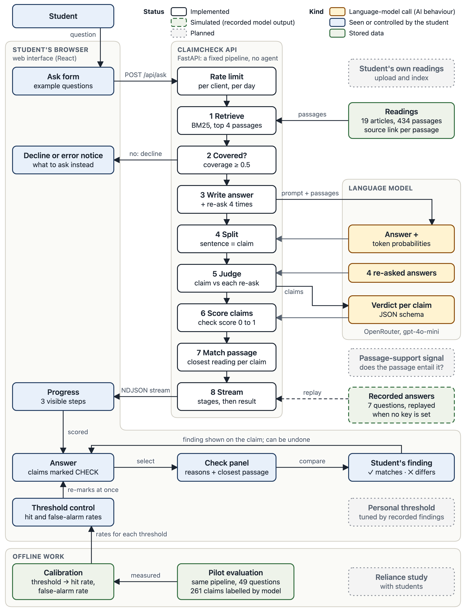

# Architecture

The diagram is generated by `scripts/draw_architecture.py`, so it is corrected in one place when the system changes.

## One question, step by step

| Step | Module | What happens | If it fails |
|---|---|---|---|
| Rate limit | `ratelimit.py` | Each client gets 8 questions per 10 minutes, and the demo 400 per day. | An error event says when to ask again. |
| 1 Retrieve | `retrieval.py` | BM25 ranks the 434 passages; the top 4 are kept. | No hits counts as not covered. |
| 2 Covered? | `pipeline.py` | The best passage must hold at least half of the question's term weight. | The system declines before any model call. |
| 3 Write answer | `pipeline.py`, `llm.py` | One call writes the answer with token probabilities; 4 parallel calls re-ask the same prompt at temperature 1. | A failed answer becomes an error event. A failed re-ask is dropped and the signal uses fewer samples. |
| 4 Split | `text.py` | Each sentence becomes one claim, with offsets into the answer. | Not applicable: the split is deterministic. |
| 5 Judge | `pipeline.py` | For each re-asked answer, one call returns a verdict per claim: supported, contradicted or not mentioned. | A failed call or a malformed verdict is ignored. |
| 6 Score | `signals.py` | The check score is the mean of (1 − lowest token probability) and the share of re-asks that do not back the claim. | A claim with no evidence is marked. An answer with no evidence for any claim becomes an error event. |
| 7 Match passage | `pipeline.py` | The passage sharing most of the claim's terms is attached, first from the 4 context passages, then from all readings. | The claim is shown with "no passage closely matches". |
| 8 Stream | `api.py` | Stage events, then the result, are written one JSON object per line. | The interface reports that the server could not be reached. |

The pipeline is a fixed sequence, not an agent. No step has an effect outside the response, so nothing needs confirmation, and the model never chooses what runs next.

## What is implemented, simulated and planned

| Part | Status | Notes |
|---|---|---|
| Web interface: ask, progress, marked answer, threshold control, check panel, findings | Implemented | `frontend/src` |
| Pipeline steps 1 to 8 with a live model | Implemented | Needs a model key |
| Decline for questions outside the readings | Implemented | Checked before and by the model |
| Pilot evaluation and calibration | Implemented, offline | [evaluation.md](evaluation.md) |
| Recorded demo | Simulated | Replays 7 unedited live results; the model is not called |
| Passage-support signal (does the passage entail the claim?) | Planned | Would add a third signal to the score |
| Student's own readings | Planned | Upload, split and index a student's files |
| Findings that tune the threshold | Planned | Use a student's ✓ and ✕ to move their default |
| Reliance study with students | Planned | The pilot measures the signal, not behaviour |

## What goes into each model call

| Content | Origin | Trust |
|---|---|---|
| System prompt | Written for this project, in `backend/src/claimcheck/prompts/` | Instruction |
| Question | The student | Information: it selects passages and is answered, not obeyed |
| 4 passages | Wikipedia, through retrieval | Information: the prompt says a passage is text to read, not an instruction |
| Re-asked answers and claims (judge call) | The model's own output | Information: compared, never executed |

Nothing is remembered between questions. The server stores no questions, and a student's findings stay in the browser tab.

## Where the thresholds are

Three decisions are thresholds, and each trades misses for false alarms:

- **Coverage** (0.5): lower answers more questions and risks answering from an unrelated passage.
- **Passage match** (0.5 in context, 0.4 elsewhere): lower shows a passage more often and risks showing an irrelevant one.
- **Marking** (default 0.35): the only one a student can move, with its measured rates shown beside it.
