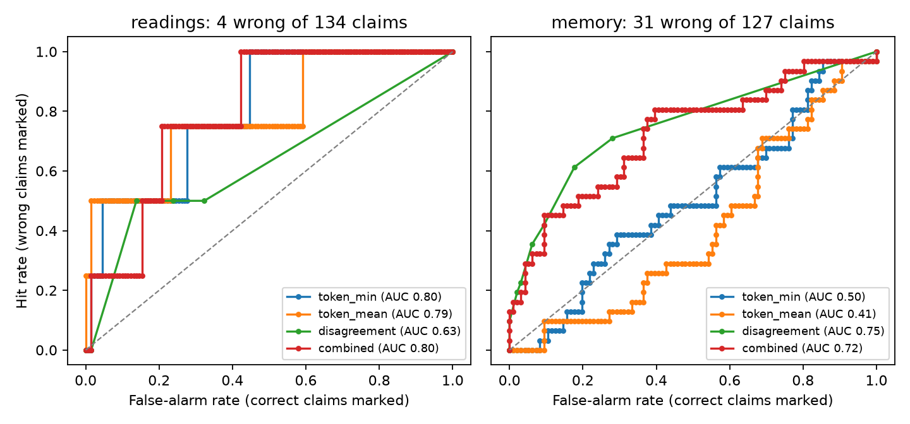

# Pilot evaluation

**Question:** how well does each signal separate wrong claims from right ones, and what does each marking threshold cost?

This is a pilot run without participants. It measures the signal, not what students do with it.

## Method

1. **Questions.** 60 passages were drawn evenly across the 19 readings (seed 11). A model (Claude Haiku 5.5) wrote one specific-fact question per passage; 49 questions resulted, because 11 replies could not be parsed. They are in `evaluation/questions.jsonl`, unedited.
2. **Answers.** Each question was answered twice by `openai/gpt-4o-mini` with the app's own pipeline:
   - **readings:** as in the app, from 4 retrieved passages;
   - **memory:** with no passages, so that the model makes errors of its own.
3. **Signals.** Every claim got the same signals as in the app (4 re-asks).
4. **Labels.** A second model (Claude Sonnet 5.5) compared each claim with the full article its question came from and labelled it correct, incorrect or unverifiable, quoting the words that decide it. The harness searched the article for each quote and discarded labels whose quote was not found.
5. **Measures.** A wrong claim that is marked is a hit; a correct claim that is marked is a false alarm. AUC is the chance that a wrong claim scores above a correct one; intervals are 95% bootstrap intervals over claims.

## Results

Of 98 runs, 5 were declined, all in the readings condition and all wrongly, since each question was written from a passage in the readings. The 93 answers held 358 claims: 95 were unverifiable against the article, 2 had a quote that could not be found, and 261 were measured.

| Data | Claims | Wrong | Token probability (lowest) | Re-ask disagreement | Combined |
|---|---|---|---|---|---|
| Readings | 134 | 4 (3%) | 0.80 (0.57 to 0.98) | 0.63 (0.32 to 0.95) | 0.80 (0.61 to 0.98) |
| Memory | 127 | 31 (24%) | 0.50 (0.39 to 0.62) | 0.75 (0.64 to 0.85) | 0.72 (0.61 to 0.83) |
| Pooled | 261 | 35 (13%) | 0.64 (0.55 to 0.73) | 0.73 (0.63 to 0.82) | 0.76 (0.67 to 0.85) |

Values are AUC with the 95% interval. `evaluation/results/roc.png` shows the curves.



What this supports:

- **Token probability alone does not find the model's own errors.** In the memory condition it is at chance (0.50). This agrees with Vasconcelos et al. (2025), who found generation probability a poor guide to what needs editing.
- **Re-ask disagreement does better** (0.75 in the memory condition), as Manakul et al. (2023) found for generated biographies.
- **Answering from the readings removes most errors** (3% wrong against 24%), which leaves too few wrong claims (4) to rank the signals in the condition the app actually runs in.

## The operating points shown in the app

The app marks a claim when the combined score reaches the threshold. Pooled over both conditions:

| Threshold | Wrong claims caught | Correct claims also marked |
|---|---|---|
| 0.20 | 97% | 81% |
| 0.30 | 86% | 53% |
| **0.35 (default)** | **80%** | **38%** |
| 0.40 | 57% | 24% |
| 0.50 | 43% | 9% |

The default is the least eager threshold that still catches three in four wrong claims: a missed wrong claim costs a student more than one needless check. At 0.35 the rates are similar in the two conditions (readings: 75% and 33%; memory: 81% and 45%).

## Limits

- **Labels were made by a model.** Each has a quote that exists in the article, but the labels have not all been checked by hand. `evaluation/results/label_review.md` lists every claim labelled incorrect with its quote, for that check.
- **Few wrong claims in the readings condition.** The pooled rates lean on the memory condition, where errors are more frequent than in the app.
- **Wrong means contradicted by the article.** Claims the article does not settle (95) were left out, so nothing here says how the signals behave on them.
- **Declining has its own misses.** 5 of 49 answerable questions were declined, so the coverage check is too cautious for some phrasings. It has not been tuned.
- **One model, one corpus, English.** The questions ask for specific facts; reasoning errors are not covered.
- **No participants.** Whether marks change what students check is a separate question.

## Reproducing it

```bash
make eval-report                       # recompute everything from the stored runs and labels
cd backend
uv run claimcheck-eval run --dir ../evaluation     # re-run the answers (needs a key)
uv run claimcheck-eval label --dir ../evaluation   # re-label (needs a key)
uv run claimcheck-eval report --dir ../evaluation --calibrate   # rewrite the app's calibration
```

Each step skips work that is already stored. To start again, delete `evaluation/results/runs.jsonl` and `labels.jsonl`. A new run will not give identical numbers, because the model's answers vary.
